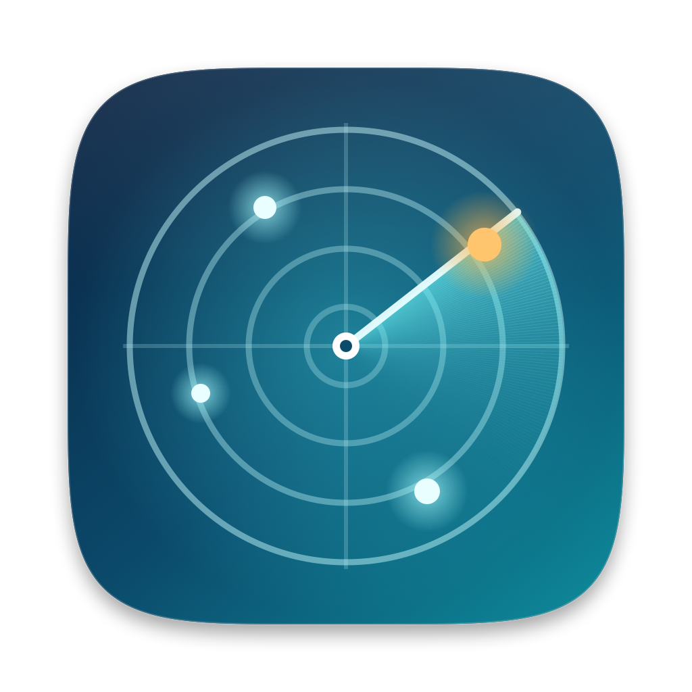
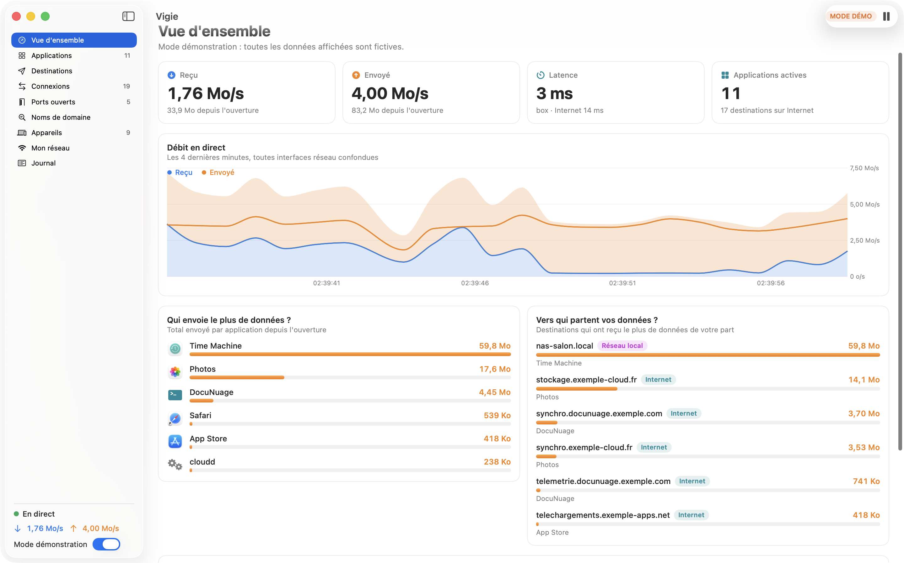
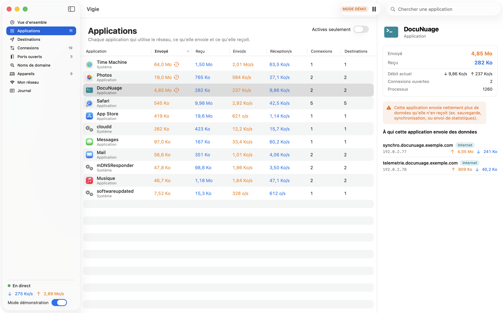
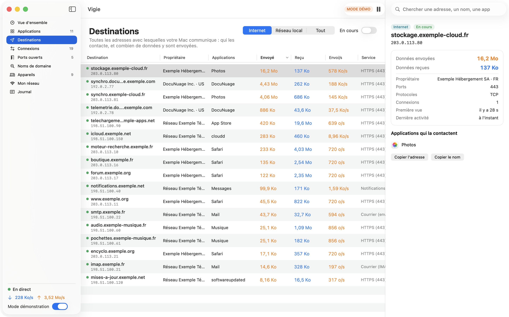
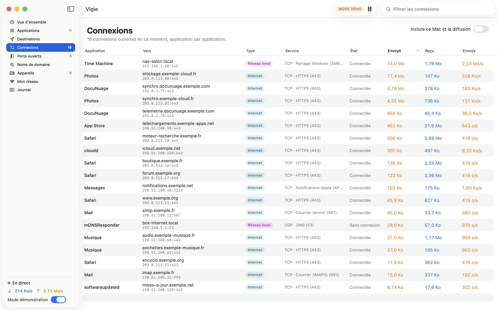
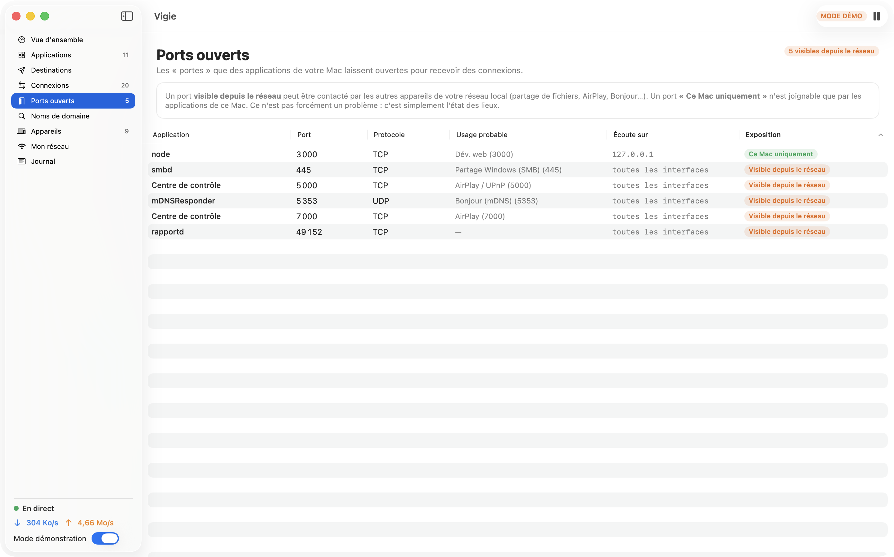
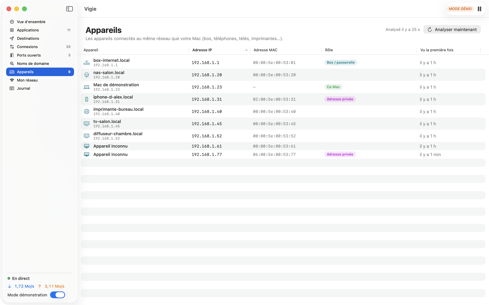
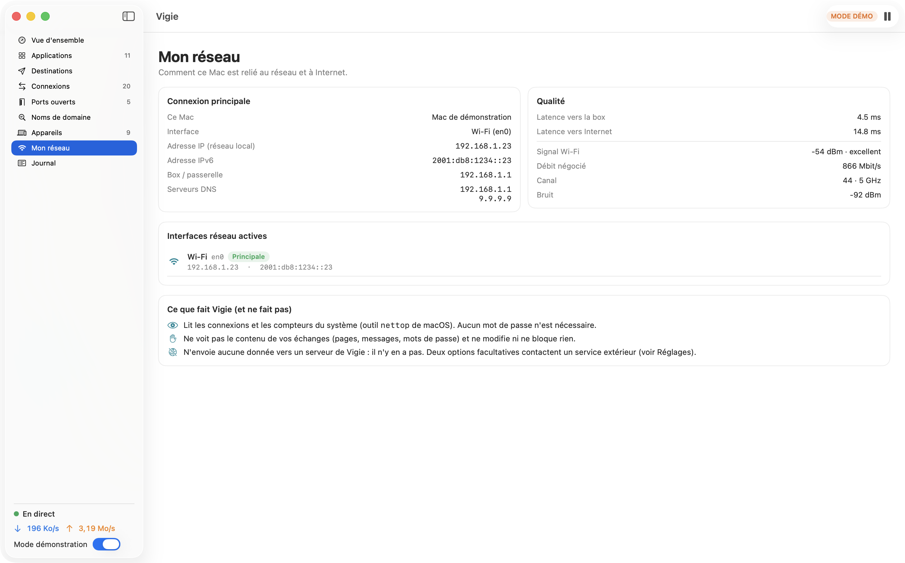
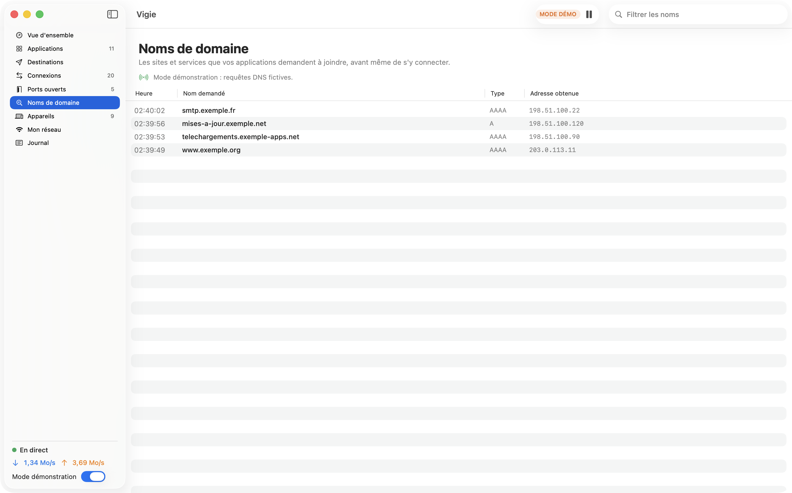
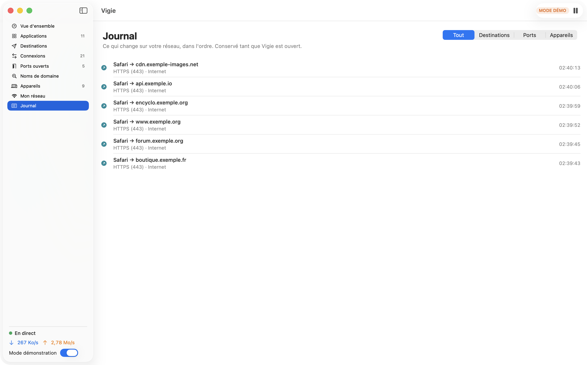

<div align="center">



# Vigie

**See everything your Mac sends over the network — and to whom.**


[🇫🇷 Français](README.md) · 🇬🇧 English



</div>

---

> **Note:** the app interface is in **French**. This README is a translation of the French one.

## What it does

Vigie is a small Mac app that answers one question: **what is happening on my network?**

- 📤 **What each application sends and receives**, in bytes and live, with its icon.
- 🎯 **Where it goes**: every address contacted, with its domain name, its owner (optional), the volume sent and received, and which apps contact it.
- ⚠️ **Flags apps that send far more than they receive** (backup, sync, telemetry…).
- 🔌 **All open connections** right now, app by app.
- 🚪 **Open ports** on your Mac, and which ones are reachable from the rest of the network.
- 📡 **Local network devices** (router, phones, TVs, printers), flagging "private" (randomized) MAC addresses.
- 📶 **Your connection**: addresses, gateway, DNS, Wi-Fi signal, latency.
- 🧾 **A journal** of changes: new destination, new open port, new device.
- 🔎 **Advanced mode (optional)**: the domain names your apps actually ask for.
- 🧪 **Demo mode**: fully fictitious data, to try the app without exposing anything.

**Read-only**: Vigie observes; it never blocks or changes anything. **Light theme only.**

## Screenshots

All taken in **demo mode** (fictitious data).

| Applications | Destinations |
|---|---|
|  |  |
| **Connections** | **Open ports** |
|  |  |
| **Devices** | **My network** |
|  |  |
| **Domain names (advanced mode)** | **Journal** |
|  |  |

## Installation

**Requirements**: an **Apple Silicon** Mac (M1 or later) running **macOS 14 Sonoma or later**. Nothing else to install (no Homebrew, Python or Node).

1. Download `Vigie-1.0.dmg` from the [Releases](../../releases) page and open it.
2. Drag **Vigie** into **Applications**.
3. **First launch** — Vigie is not signed with a paid Apple developer account (so it is not "notarized"). macOS will show a warning. **Right-click Vigie → Open → Open**. Or, in Terminal:
   ```bash
   xattr -dr com.apple.quarantine /Applications/Vigie.app
   ```
4. Optional: verify the download with the SHA-256 given on the release page (`shasum -a 256 Vigie-1.0.dmg`).

## Getting started

1. Open Vigie: the **Overview** fills in within seconds. No password is asked.
2. To try it without exposing anything: switch on **"Mode démonstration"** at the bottom of the sidebar.
3. **Applications** → click a row: the right panel lists *who* the app sends data to.
4. **Destinations** → filter on "Internet" and sort by "Envoyé" (sent).
5. **Appareils** (devices) → macOS may ask permission for **local network** access: accept it to see the list.
6. Settings (⌘ ,): domain names, address owners, latency, speed in the menu bar.

## What Vigie sees… and doesn't

| Vigie sees | Vigie does not see |
|---|---|
| Which app opens a connection | The **content** of exchanges (pages, messages, passwords) |
| To which address and port | What is said *inside* an encrypted connection (nearly all of the web) |
| How many bytes are sent / received | Connections shorter than ~1 second |
| Ports open on your Mac | Other devices' traffic on your network |

This is the same level of information as macOS's built-in `nettop` tool (which Vigie relies on, without administrator rights). Going down to packet contents would require a full capture tool (e.g. Wireshark) with admin rights — out of Vigie's scope.

## Privacy: what leaves your Mac

Vigie has **no server** and sends **no analytics**. Here is *everything* it can cause to be sent:

| Feature | What is sent, and to whom | Setting |
|---|---|---|
| Domain names | Each contacted address is submitted to **your usual DNS server** (router, ISP) | On · can be disabled |
| Address owners | Contacted Internet addresses are sent to **rdap.org** (public registry) | **Off by default** |
| Latency | A "ping" to your router, and to `1.1.1.1` | Internet: on · can be disabled |
| Devices | A small UDP packet to each address on **your local network** (nothing leaves the network) | On demand |
| Advanced mode | Nothing sent; reads DNS requests via `tcpdump` (admin password entered in the official macOS dialog, **never seen by Vigie**) | Off · on demand |

## Compatibility and known limits

**What was tested** (honestly):
- macOS **26.6.2**, Apple Silicon Mac: build, **14 unit tests**, launch in **real mode** (real connections, domain names, devices, Wi-Fi) and in **demo mode**.
- Launch in a **sandbox with no access to Homebrew** (`tests/smoke_test.sh`), on the same Mac.
- Measured load: about **2% of one core** for the app.

**What was not tested**:
- **macOS 14 and 15**: the minimum (14.0) is verified in the binary from the APIs used, but the app was not run on those versions.
- **Intel Macs**: not supported (arm64 build only).
- **Advanced mode (domain names)**: `tcpdump` line parsing is tested on samples, but the authorization dialog and live capture were **not** tested end to end.
- **Address owners**: the RDAP service response was checked on a public address, but the feature was not observed over time in the app.
- **No test on a corporate network, behind a proxy, or with several VPNs.**

**Known limits**:
- Totals are **"since Vigie was opened"**; nothing is kept after closing.
- Names from reverse DNS are often a host's (e.g. `ec2-…amazonaws.com`) rather than the site visited. Advanced mode gives the real requested name… unless the app uses encrypted DNS.
- Device **manufacturers** are not identified; names only appear if announced on the network (mDNS / DNS).
- The **Wi-Fi network name (SSID)** is not shown (macOS reserves it for apps allowed to use location).
- Counted bytes are *socket* bytes: they exclude network headers, so they differ slightly from your router's counters.

## Build from source

You need Xcode (or the Command Line Tools) with Swift ≥ 5.9. Tested with Swift 6.2.

```bash
./build_app.sh          # builds build/Vigie.app (arm64, ad hoc signature)
```
```bash
./make_dmg.sh           # builds build/Vigie-1.0.dmg + its SHA-256
```
```bash
swift test              # 14 unit tests
```
```bash
tests/smoke_test.sh     # launches the app without Homebrew access and checks its 9 screens
```
```bash
scripts/make_icns.sh    # regenerates the icon (icon/icon.icns, docs/icon.png)
```

Documentation screenshots are redone with `build/Vigie.app/Contents/MacOS/Vigie --capture docs/screenshots` (demo mode).

## Code layout

| File | Role |
|---|---|
| `Sources/Vigie/NettopMonitor.swift`, `NettopParser.swift` | One-shot `nettop` snapshot every second, output parsing |
| `Sources/Vigie/NetworkStore.swift` | The "brain": aggregates apps, destinations, connections, ports, journal |
| `Sources/Vigie/Resolvers.swift`, `AppIdentity.swift` | Domain names, owners (RDAP), app identification |
| `Sources/Vigie/LANScanner.swift`, `SystemInfo.swift` | Local devices, interfaces, DNS, Wi-Fi, latency |
| `Sources/Vigie/DNSSniffer.swift` | Advanced mode: reading DNS requests |
| `Sources/Vigie/DemoSource.swift` | Demo mode (fictitious data) |
| `Sources/Vigie/*View.swift`, `Components.swift` | SwiftUI interface |
| `icon/`, `scripts/` | Icon generation |
| `tests/` | Unit tests, smoke test, sandbox profile |

## Contributing

Ideas and fixes are welcome: open an *issue* to discuss, or a *pull request* (with a test if possible). Please **never** include real data from your network (addresses, device names): use the documentation ranges (`192.0.2.0/24`, `198.51.100.0/24`, `203.0.113.0/24`).

## License

[MIT](LICENSE) © 2026 Wudstyz. See also [THIRD_PARTY_NOTICES.md](THIRD_PARTY_NOTICES.md). Product names mentioned belong to their owners; this project is not affiliated with any of them.
