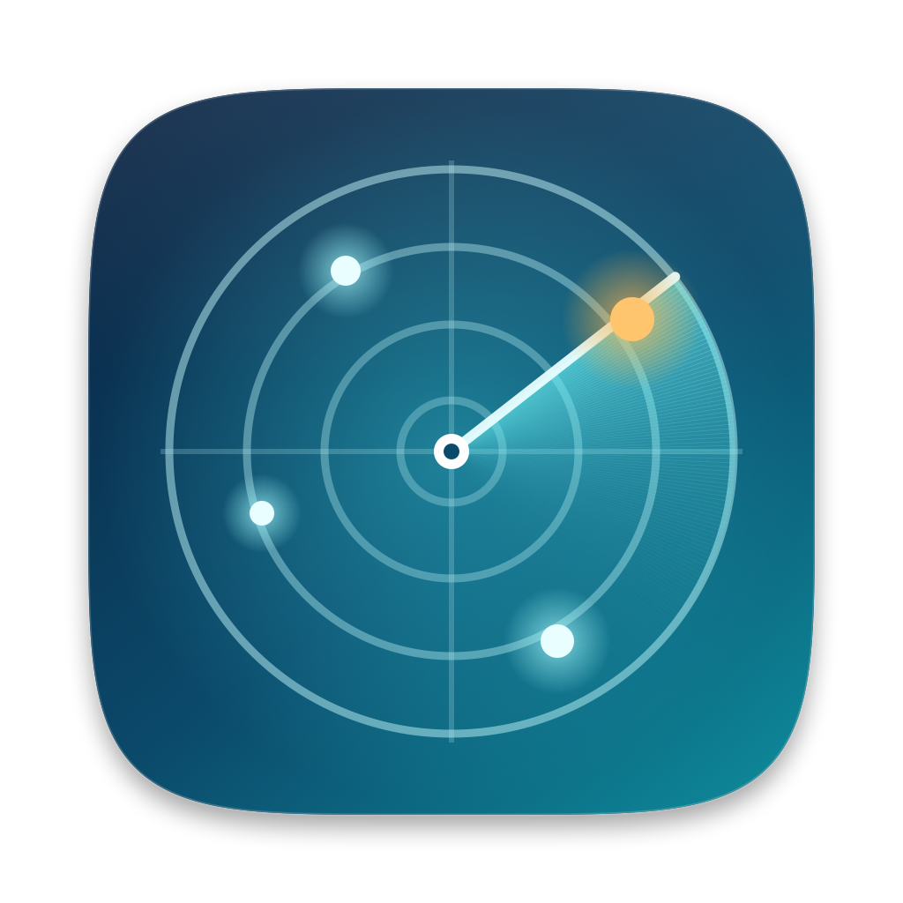
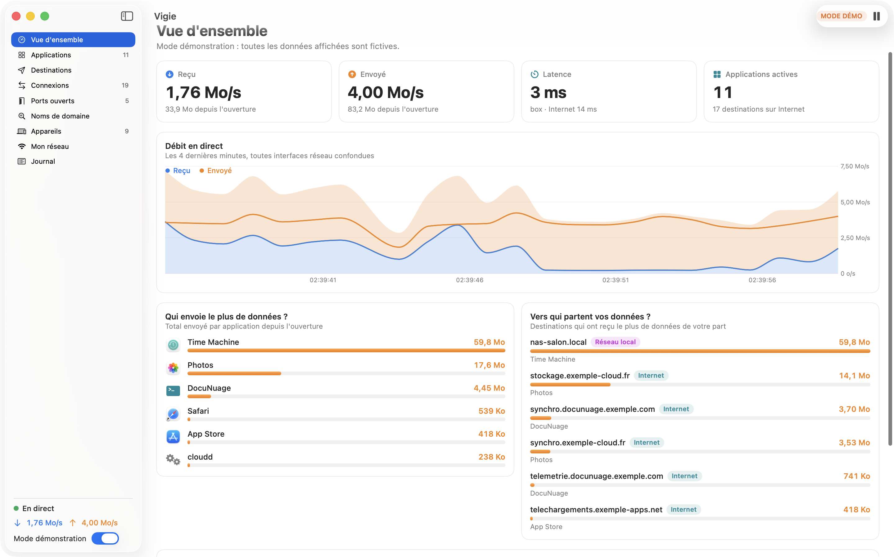
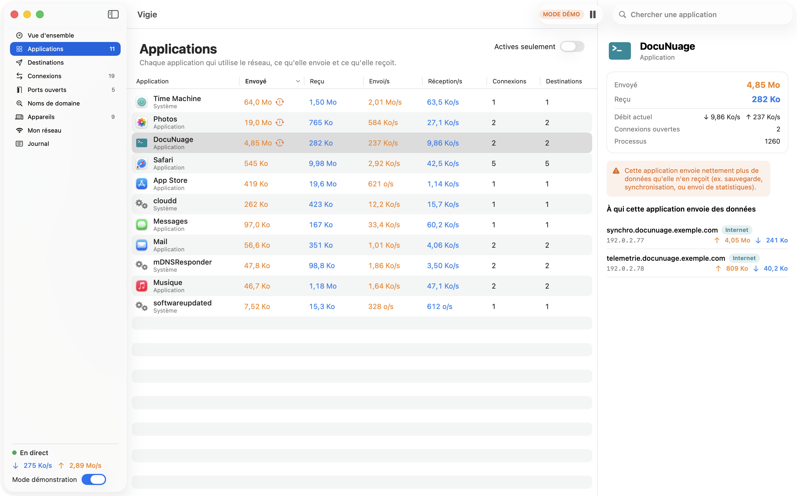
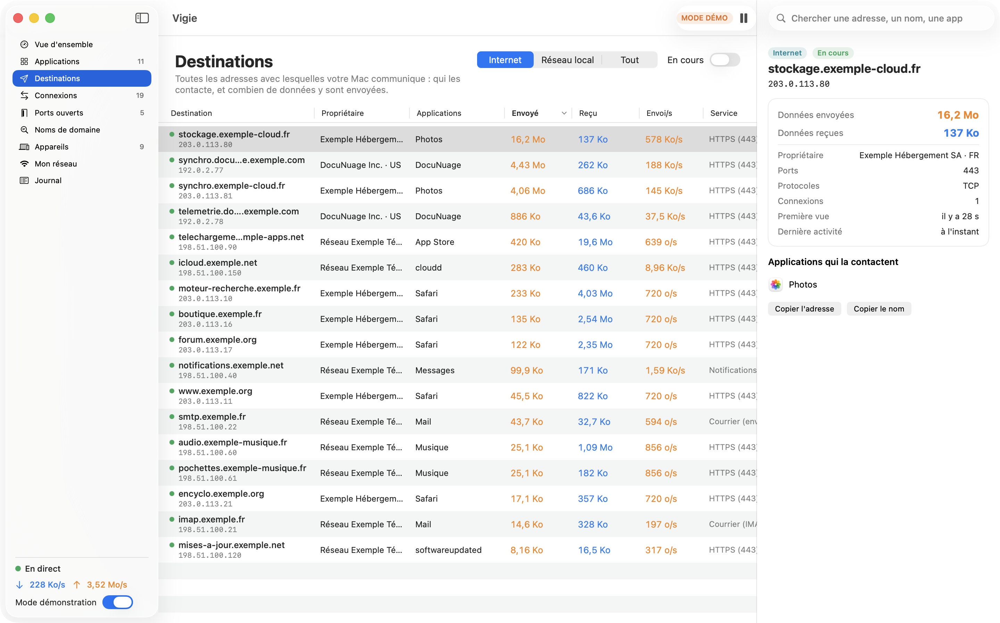
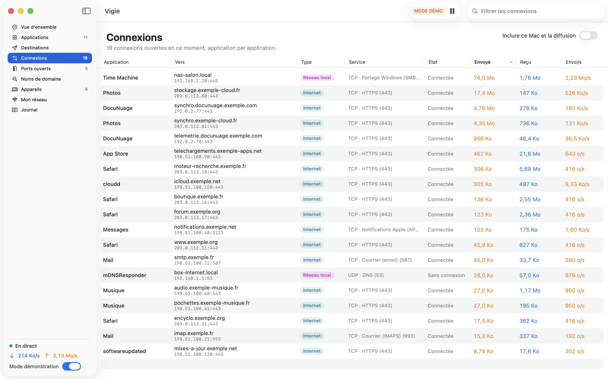
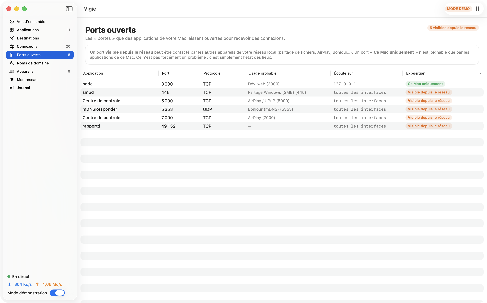
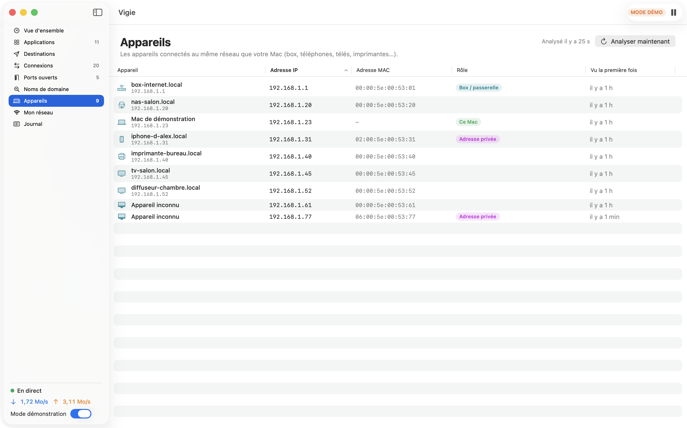
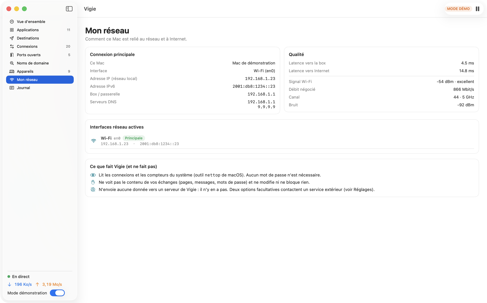
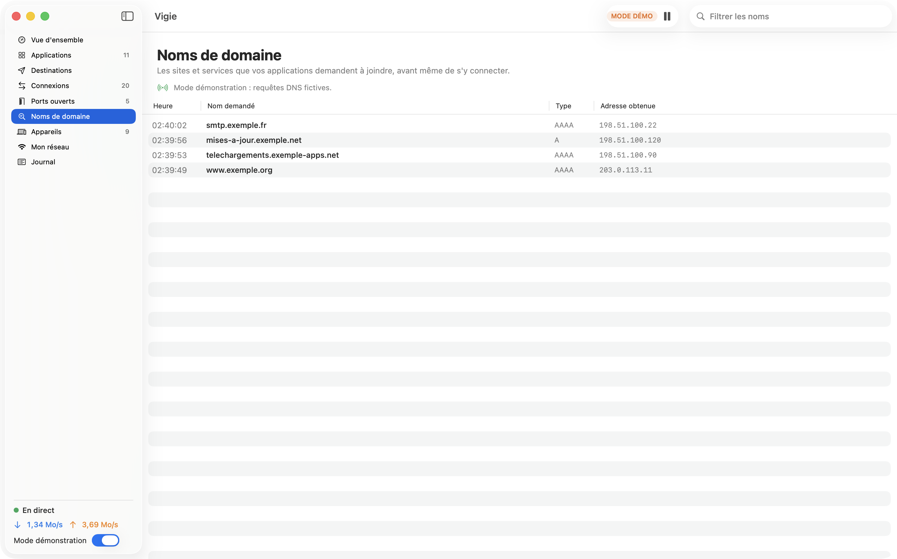
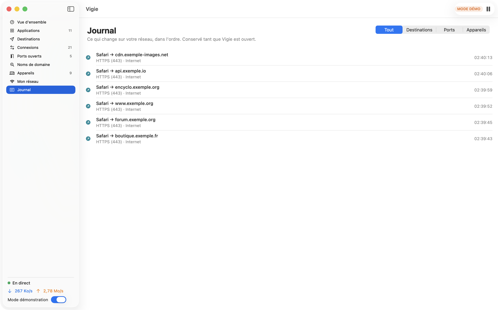

<div align="center">



# Vigie

**Voyez tout ce que votre Mac envoie sur le réseau — et à qui.**


🇫🇷 Français · [🇬🇧 English](README.en.md)



</div>

---

## Ce que ça fait

Vigie est une petite app Mac, en français, qui répond à une question simple : **que se passe-t-il sur mon réseau ?**

- 📤 **Ce que chaque application envoie et reçoit**, en octets et en direct, avec son icône.
- 🎯 **À qui ça part** : toutes les adresses contactées, avec leur nom de domaine, leur propriétaire (en option), le volume envoyé et reçu, et quelles applications les contactent.
- ⚠️ **Repère les applications qui envoient bien plus qu'elles ne reçoivent** (sauvegarde, synchronisation, statistiques…).
- 🔌 **Toutes les connexions ouvertes** en ce moment, application par application.
- 🚪 **Les ports ouverts** sur votre Mac, et lesquels sont visibles depuis le reste du réseau.
- 📡 **Les appareils du réseau local** (box, téléphones, télés, imprimantes), avec repérage des adresses « privées ».
- 📶 **Votre connexion** : adresses, passerelle, DNS, signal Wi-Fi, latence.
- 🧾 **Un journal** des nouveautés : nouvelle destination, nouveau port ouvert, nouvel appareil.
- 🔎 **Mode avancé (facultatif)** : les noms de domaine réellement demandés par vos applications.
- 🧪 **Mode démonstration** : des données entièrement fictives pour essayer l'app sans rien exposer.

**Lecture seule** : Vigie observe, elle ne bloque et ne modifie rien. Elle ne tourne qu'en **thème clair**.

## Captures d'écran

Toutes prises en **mode démonstration** (données fictives).

| Applications | Destinations |
|---|---|
|  |  |
| **Connexions** | **Ports ouverts** |
|  |  |
| **Appareils** | **Mon réseau** |
|  |  |
| **Noms de domaine (mode avancé)** | **Journal** |
|  |  |

## Installation

**Prérequis** : un Mac **Apple Silicon** (M1 ou plus récent) sous **macOS 14 Sonoma ou plus**. Rien d'autre à installer (ni Homebrew, ni Python, ni Node).

1. Téléchargez `Vigie-1.0.dmg` dans la page [Releases](../../releases) et ouvrez-le.
2. Glissez **Vigie** dans **Applications**.
3. **Première ouverture** — Vigie n'est pas signée par un compte développeur Apple payant (donc pas « notarisée »). macOS affichera un avertissement. Faites un **clic droit sur Vigie → Ouvrir → Ouvrir**. Ou, dans le Terminal :
   ```bash
   xattr -dr com.apple.quarantine /Applications/Vigie.app
   ```
4. Facultatif : vérifiez le téléchargement avec la somme SHA-256 donnée dans la page de la release (`shasum -a 256 Vigie-1.0.dmg`).

## Premiers pas

1. Ouvrez Vigie : la **Vue d'ensemble** se remplit en quelques secondes. Aucun mot de passe n'est demandé.
2. Pour essayer sans rien exposer : activez **« Mode démonstration »** en bas de la barre latérale.
3. **Applications** → cliquez une ligne : le panneau de droite liste *à qui* l'application envoie des données.
4. **Destinations** → filtrez sur « Internet » et triez par « Envoyé ».
5. **Appareils** → macOS peut demander l'autorisation d'accéder au **réseau local** : acceptez pour voir la liste.
6. Réglages (⌘ ,) : noms de domaine, propriétaires des adresses, latence, débit dans la barre des menus.

## Ce que Vigie voit… et ne voit pas

| Vigie voit | Vigie ne voit pas |
|---|---|
| Quelle application ouvre une connexion | Le **contenu** des échanges (pages, messages, mots de passe) |
| Vers quelle adresse et quel port | Ce qui est dit *à l'intérieur* d'une connexion chiffrée (la quasi-totalité du web) |
| Combien d'octets sont envoyés / reçus | Les connexions plus courtes que ~1 seconde |
| Les ports ouverts sur votre Mac | Le trafic des autres appareils du réseau |

C'est le même niveau d'information que l'outil `nettop` fourni avec macOS (Vigie s'appuie dessus, sans droits administrateur). Pour aller jusqu'au contenu des paquets, il faudrait un outil de capture complet (ex. Wireshark) avec les droits administrateur — hors du périmètre de Vigie.

## Vie privée : ce qui sort de votre Mac

Vigie n'a **aucun serveur** et n'envoie **aucune statistique**. Voici *tout* ce qui peut générer du trafic de son fait :

| Fonction | Ce qui est envoyé, et à qui | Réglage |
|---|---|---|
| Noms de domaine | Chaque adresse contactée est soumise à **votre serveur DNS habituel** (box, opérateur) | Activé · désactivable |
| Propriétaires des adresses | Les adresses Internet contactées sont envoyées à **rdap.org** (annuaire public) | **Désactivé par défaut** |
| Latence | Un « ping » vers votre box, et vers `1.1.1.1` | Internet : activé · désactivable |
| Appareils | Un petit paquet UDP à chaque adresse de **votre réseau local** (rien ne sort du réseau) | Au besoin |
| Mode avancé | Aucun envoi ; lit les requêtes DNS via `tcpdump` (mot de passe administrateur saisi dans la fenêtre officielle de macOS, **jamais vu par Vigie**) | Désactivé · à la demande |

## Compatibilité et limites connues

**Ce qui a été testé** (honnêtement) :
- macOS **26.6.2**, Mac Apple Silicon : compilation, **14 tests unitaires**, lancement en **mode réel** (vraies connexions, noms de domaine, appareils, Wi-Fi) et en **mode démonstration**.
- Lancement dans un **bac à sable sans accès à Homebrew** (`tests/smoke_test.sh`), sur ce même Mac.
- Consommation mesurée : environ **2 % d'un cœur** pour l'app.

**Ce qui n'a pas été testé** :
- **macOS 14 et 15** : le minimum (14.0) est vérifié dans le binaire d'après les API utilisées, mais l'app n'a pas été lancée sur ces versions.
- **Mac Intel** : non pris en charge (build arm64 uniquement).
- **Mode avancé (noms de domaine)** : l'analyse des lignes `tcpdump` est testée sur des exemples, mais l'ouverture de la fenêtre d'autorisation et la capture réelle n'ont **pas** été testées de bout en bout.
- **Propriétaires des adresses** : la réponse du service RDAP a été vérifiée sur une adresse publique, mais la fonction n'a pas été observée longuement dans l'app.
- **Aucun test sur un réseau d'entreprise, avec proxy, ou avec plusieurs VPN.**

**Limites connues** :
- Les totaux sont **« depuis l'ouverture de Vigie »** ; rien n'est conservé après la fermeture.
- Les noms obtenus par DNS inverse sont souvent ceux d'un hébergeur (ex. `ec2-…amazonaws.com`) et non du site visité. Le mode avancé donne le vrai nom demandé… sauf si l'app utilise un DNS chiffré.
- Le **fabricant** des appareils n'est pas identifié ; leur nom n'apparaît que s'il est annoncé par le réseau (mDNS / DNS).
- Le **nom du réseau Wi-Fi (SSID)** n'est pas affiché (macOS le réserve aux apps autorisées à utiliser la localisation).
- Les octets comptés sont ceux des *sockets* : ils excluent les en-têtes réseau, donc diffèrent un peu des compteurs de votre box.

## Construire depuis les sources

Il faut Xcode (ou les « Command Line Tools ») avec Swift ≥ 5.9. Testé avec Swift 6.2.

```bash
./build_app.sh          # construit build/Vigie.app (arm64, signature « ad hoc »)
```
```bash
./make_dmg.sh           # construit build/Vigie-1.0.dmg + sa somme SHA-256
```
```bash
swift test              # 14 tests unitaires
```
```bash
tests/smoke_test.sh     # lance l'app sans accès à Homebrew et vérifie ses 9 écrans
```
```bash
scripts/make_icns.sh    # régénère l'icône (icon/icon.icns, docs/icon.png)
```

Les captures de la documentation se refont avec `build/Vigie.app/Contents/MacOS/Vigie --capture docs/screenshots` (mode démonstration).

## Organisation du code

| Fichier | Rôle |
|---|---|
| `Sources/Vigie/NettopMonitor.swift`, `NettopParser.swift` | Relevé ponctuel de `nettop` chaque seconde, lecture de sa sortie |
| `Sources/Vigie/NetworkStore.swift` | Le « cerveau » : agrège apps, destinations, connexions, ports, journal |
| `Sources/Vigie/Resolvers.swift`, `AppIdentity.swift` | Noms de domaine, propriétaires (RDAP), identification des applications |
| `Sources/Vigie/LANScanner.swift`, `SystemInfo.swift` | Appareils du réseau local, interfaces, DNS, Wi-Fi, latence |
| `Sources/Vigie/DNSSniffer.swift` | Mode avancé : lecture des requêtes DNS |
| `Sources/Vigie/DemoSource.swift` | Mode démonstration (données fictives) |
| `Sources/Vigie/*View.swift`, `Components.swift` | Interface SwiftUI |
| `icon/`, `scripts/` | Génération de l'icône |
| `tests/` | Tests unitaires, test de fumée, profil de bac à sable |

## Contribuer

Les idées et corrections sont les bienvenues : ouvrez une *issue* pour en discuter, ou une *pull request* (avec un test si possible). Merci de ne **jamais** y inclure de données réelles de votre réseau (adresses, noms d'appareils) : utilisez les plages de documentation (`192.0.2.0/24`, `198.51.100.0/24`, `203.0.113.0/24`).

## Licence

[MIT](LICENSE) © 2026 Wudstyz. Voir aussi [THIRD_PARTY_NOTICES.md](THIRD_PARTY_NOTICES.md). Les marques citées appartiennent à leurs propriétaires ; ce projet n'est affilié à aucun d'eux.
